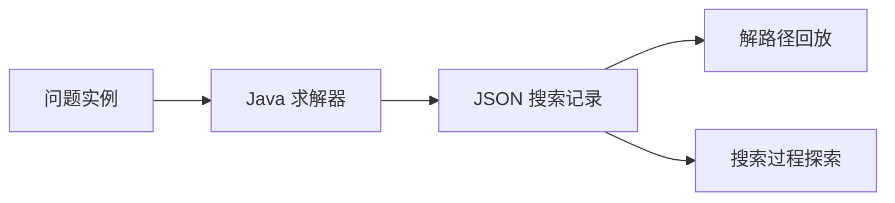

<h1 align="center">OUC AI · N-Puzzle</h1>

<p align="center">8 数码与 15 数码求解 · 启发式搜索过程可视化</p>

<p align="center">
  <a href="https://github.com/szhhwh/ouc-ai-npuzzle/actions/workflows/ci.yml"></a>
  
  
  
</p>

<p align="center">
  <a href="https://szhhwh.github.io/ouc-ai-npuzzle/"><strong>在线体验 ↗</strong></a>
  &nbsp; · &nbsp;
  <a href="#快速开始">快速开始</a>
  &nbsp; · &nbsp;
  <a href="#本地开发">本地开发</a>
</p>

基于中国海洋大学人工智能课程搜索框架，实现 N-Puzzle 最短路径求解与搜索过程可视化。Java 求解器导出 JSON 记录，网页回放解路径、节点扩展与剪枝过程，无需部署服务端。

## 核心功能

| 模块 | 内容 |
| :--- | :--- |
| 搜索算法 | A\*、IDA\*、Dijkstra，以及 N-Puzzle 专用 IDA\*（`nida`） |
| 启发函数 | 零估计、错位数、曼哈顿距离、可加模式数据库（PDB） |
| 求解优化 | 紧凑棋盘编码、增量查表、对称增强、状态去重与磁盘缓存 |
| 可视化 | 解路径动画、启发值曲线、搜索树探索、节点估值与剪枝原因 |
| 记录管理 | JSON 批量导入、重命名与浏览器本地持久化 |

PDB 分组：三阶 **3–3–2**，四阶通用搜索 **6–6–3**，四阶专用搜索 **7–8**。



## 在线体验

访问 **[可视化页面](https://szhhwh.github.io/ouc-ai-npuzzle/)**，点击「加载 3×3 示范样例」，或拖入导出的 JSON 文件。

支持播放、单步、进度定位和搜索树缩放；点击节点可查看 $g$、$h$、$f$、迭代阈值及剪枝原因。记录保存在当前浏览器中。

## 快速开始

求解器需要 **JDK 25**，Maven 已由仓库内置 Wrapper 提供。以下命令使用 Bash，Windows 可在 Git Bash 中执行。

```bash
git clone https://github.com/szhhwh/ouc-ai-npuzzle.git
cd ouc-ai-npuzzle

# 求解一个三阶示例，脚本会自动编译
bash scripts/run.sh problems-demo.txt astar MANHATTAN

# 导出搜索记录，将 results-demo.json 拖入在线页面回放
bash scripts/export-visualization.sh resources/problems-demo.txt results-demo.json astar MANHATTAN
```

引擎可选 `astar`、`ida`、`nida`、`dijkstra`；启发函数可选 `ZERO`、`MISPLACED`、`MANHATTAN`、`DISJOINT_PATTERN`，多个值用逗号分隔。

```bash
# 比较基础启发函数
bash scripts/run.sh problems-stage1.txt astar MISPLACED,MANHATTAN

# 用专用 IDA* + PDB 求解困难十五数码
JAVA_OPTS='-Xmx4g' bash scripts/run.sh problems-stage3.txt nida DISJOINT_PATTERN
```

更多实例见 [resources/](resources/)。自定义输入每行一个问题，`0` 表示空格：

```text
n  <n*n 个初始状态数字>  <n*n 个目标状态数字>
```

PDB 首次使用时自动建表，缓存位于 `resources/pdb-cache/`，四阶建表需要较多时间与内存。导出 PDB 记录时，需追加 `--allow-pdb`；输出文件已存在时拒绝覆盖。导出耗时包含搜索过程采集开销。

## 项目结构

```text
src/core/                  通用搜索框架与评测入口
src/stud/g01/              N-Puzzle 建模、专用搜索、PDB 与记录导出
src/stud/queue/            优先队列与状态索引
resources/                 问题实例
scripts/                   编译、运行与导出脚本
visualization/             React + TypeScript 可视化前端
```

## 本地开发

Java 编译与质量检查：

```bash
./mvnw -B -ntp verify
```

前端使用 **React 19 · TypeScript · Vite 8 · Tailwind CSS 4 · D3 + Canvas**，通过 Bun 开发与构建：

```bash
cd visualization
bun install --frozen-lockfile
bun run dev      # 本地预览，默认 http://localhost:5173
bun run test     # 自动化测试
bun run build    # 类型检查与生产构建
```

构建产物为 `visualization/dist/index.html`，可单文件离线打开。[CI](.github/workflows/ci.yml) 执行 Java 质量检查、前端测试与构建；[Pages](.github/workflows/pages.yml) 发布可视化页面。
